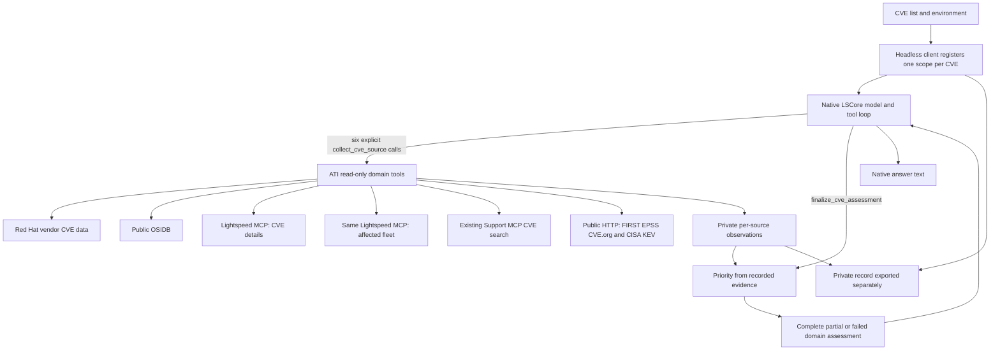

# Journey 01 with native LSCore

The current PoC assesses explicit CVEs against one configured customer connection
through prioritization. LSCore owns the model/tool loop. ATI supplies source
collectors, evidence records and the provisional priority rule through MCP.

The six collectors are fetching operations, not six MCP services. The four core
source families are Red Hat Security Data, OSIDB, Lightspeed MCP and Support MCP.
The `lightspeed` and `fleet` collectors share one Lightspeed connection: one reads
CVE details; the other finds affected hosts and reads their inventory/profiles.
The `threat_intel` collector adds public HTTP feeds from FIRST EPSS, CVE.org
(CISA exploitation assessments) and CISA KEV for the priority decision.
See the [collector-to-source table](README.md#six-collectors-and-their-sources).

| Journey step | Current behavior and limit |
|---|---|
| Headless list | One native query per CVE; fresh assessment IDs; default two concurrent requests. No MAS dependency. |
| Active RHEL footprint | CVE-specific affected systems, then details/profiles only for returned IDs. At most ten hosts and two CVE pages. Active means RHEL check-in within 30 days, not proven uptime. Positive live hosts remain unverified. |
| Support aggregation | The accepted existing MCP searches the explicit CVE, including closed cases when supported, at most five hits. Query-only matches remain unverified. The latest real-source run returned a source failure. |
| Exploit context | Public vendor and OSIDB data, FIRST EPSS, CVE.org/CISA assessment and CISA known-exploited catalog. Missing or stale evidence stays explicit. |
| Prioritization | Default rule: affected systems above zero AND either reported public exploit availability or observed exploitation gives `urgent_review`. A complete zero lookup gives `no_affected_systems`; otherwise `needs_review`. EPSS supports context. |
| Results | Native answer text plus an independently saved domain record. Native A2A does not preserve ATI's typed record or domain outcome automatically. |

The optional `manual_review` rule always requests review. Priority is a
provisional PoC policy, not authorization to change customer systems. The source
timeout defaults to 35 seconds inside one MCP collector. The 240-second headless
timeout limits client waiting; it is not a native server whole-run deadline.
Native LSCore schedules the collector calls; the pinned backend ran them sequentially.

Source errors are returned as safe domain data and retained in private SQLite
records. If the model fails before `finalize_cve_assessment`, earlier observations
survive but the assessment remains `not_finalized`. The domain store is not
LSCore's task store, and saving evidence does not resume an interrupted agent.

The [verification receipt](verification.json) separates a successful synthetic
positive run from the real-source partial run. Synthetic evidence is labelled
`synthetic_fixture`; it must never be presented as customer impact.

## Original remediation plan

The original ATI design planned future L3 capability:
**recommend a fix → generate a playbook → human approval → execute through
Ansible Automation Platform → inspect again**. A generic `generate_playbook`
tool was proposed; the documents did not select Ansible Lightspeed as its
implementation. UI approval, a durable workflow that pauses/resumes, and AAP
integration were separate responsibilities.

The documents left the generation/execution handoff, consistent approval trigger,
and rollback procedure unresolved. The five-minute downtime example was not a
measured estimate. None of that remediation flow is implemented here. Errata
enrichment is also excluded, as requested. See the [original design](https://github.com/zvigrinberg/actionable-threat-intelligence/blob/76cd662075f185ad60636c15901de179bd2dc883/docs/rh-security-agent-design-document.md)
and [remediation evidence](experiments/lscore-core-evaluation/results/journey-remediation-plan.json).
