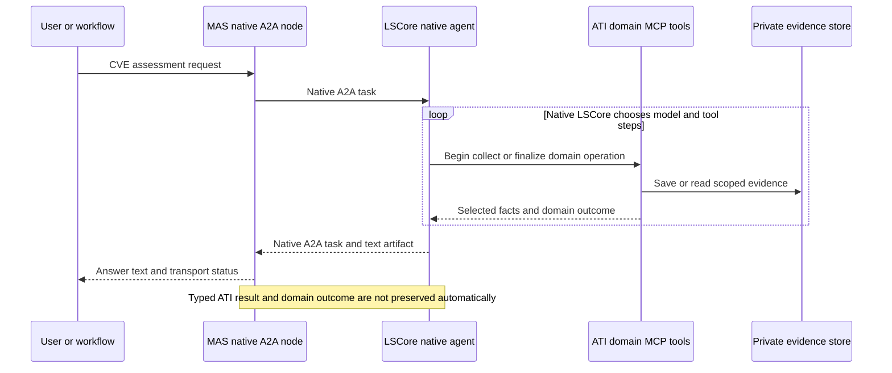

# Native LSCore downstream integration with MAS

MAS invokes LSCore's native A2A endpoint, and LSCore owns the model/tool loop.
The native Agent Card is served
at `/.well-known/agent-card.json`; this pin advertises A2A `0.3.0` at `/a2a`.
LSCore's SDK is `0.3.26`. The checked MAS baseline used SDK `1.3.1`, whose card
resolver accepts the legacy wire format. Keep their dependency environments separate.



Use an existing local MAS installation. The helper uses that installation's
Agent Card parser, then registers a native A2A node and a minimal
**input → LSCore → final answer** workflow. It registers or updates the native
LSCore endpoint without patching or vendoring MAS.

From this directory, using the compatible MAS environment's Python:

```bash
<MAS_PYTHON> scripts/mas_native.py
```

To exercise the workflow, add `--prompt 'Assess CVE-2023-38545 in environment
connected-organization'`. The helper writes raw chat/results privately to
`.local/reports/mas-native.json`. Its API is restricted to loopback development
services. Existing MAS setup, storage, worker and UI remain external prerequisites.

## Result boundary

Native LSCore does not emit ATI's domain JSON as an A2A DataPart. Model-printed
JSON is still text. An A2A completed task therefore does not establish a complete
assessment, and MAS transport success must not be interpreted as full evidence.

Use the headless client's known assessment ID and the explicit local
`show-assessment` command to inspect the domain record. That is a separate export,
not automatic MAS artifact preservation. A supported structured A2A adapter or
upstream contract change remains follow-up work; neither is silently simulated.

See [verification.json](verification.json) for the actual native query and MAS
checks. Neutral native-node tests are recorded
in the [LSCore evaluation](experiments/lscore-core-evaluation/REPORT.md).
