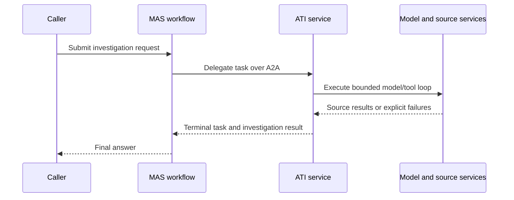

# MAS integration for the independent ATI agent

MAS invokes ATI as a separate service through its native outbound A2A node.
The agent owns its internal planning, model and tool calls, source credentials,
and investigation records. MAS owns the surrounding workflow, its conversation,
delegation, and final response. Direct clients can use ATI without MAS.



## Registration and selection

`scripts/mas_workflow.py` fetches ATI's Agent Card, stores its capability metadata
in a MAS A2A inventory resource, and saves a fixed delegation workflow.

The [selection workflow](SELECTION.md) adds a MAS coordinator and a second agent.
The coordinator selects among its connected, permitted workers using their
capability descriptions. An inventory entry alone does not make an agent a
candidate in every workflow. The PoC does not demonstrate automatic discovery
and selection across an entire registry.

An Agent Card describes an endpoint, capabilities, and security requirements.
Its declared skills are capability metadata, not `SKILL.md` files.

## Optional local platform setup

ATI itself needs only the [standalone setup](README.md#run-the-agent). To recreate
the full development lab, obtain access to compatible MAS and MAS UI Git
repositories, then configure their URLs:

```bash
export MAS_REPOSITORY_URL='<MAS-git-url>'
export MAS_UI_REPOSITORY_URL='<MAS-UI-git-url>'
bash scripts/bootstrap.sh
```

Use the pinned revisions in [the version baseline](VERSION_AUDIT.md). The script
installs private Python/Node runtimes and platform checkouts under ignored
`.local/`, installs dependencies, and applies the two MAS compatibility patches.
It requires Linux x86_64, Git, uv/uvx, curl, tar, and sha256sum. Running the
infrastructure additionally requires Podman and a Compose provider.

```bash
podman compose -f compose.yaml up -d
```

Start the following commands in separate terminals, in this order:

```bash
bash scripts/run-platform.sh api
```

```bash
bash scripts/run-platform.sh worker
```

```bash
uv run --locked ati-downstream serve
```

| Service | Local address |
|---|---|
| MAS API | `http://127.0.0.1:8111/api` |
| ATI | `http://127.0.0.1:8120` |
| Temporal development UI | `http://127.0.0.1:8234` |
| MongoDB | `127.0.0.1:27118` |
| Redis | `127.0.0.1:6381` |

The API starts before the worker to avoid a reproduced first-start settings
seeding race. These services use local development authentication, not production
identity propagation. The helpers send a development-only MAS bearer value;
ATI requires its separately configured token.

## Optional MAS UI

The pinned UI uses the hosted console shell and sign-in. It is not an offline UI.
Add these local development hostnames to `/etc/hosts` only if needed:

```text
127.0.0.1 stage.foo.redhat.com prod.foo.redhat.com qa.foo.redhat.com ci.foo.redhat.com ephemeral.foo.redhat.com
```

```bash
bash scripts/run-platform.sh ui
```

Open `https://stage.foo.redhat.com:1337/settings/mas/`, complete console sign-in,
and set **MAS SA service URL** to `/mas-api`. Verify the selected backend before
loading a workflow; existing browser settings can override defaults.

Startup creates a hostname-specific development certificate under `.local/`.
It does not change browser or system trust. If explicitly desired on Linux,
`bash scripts/ui-cert-trust.sh add` trusts that server certificate in Chrome's
NSS database; `status` inspects it and `remove` reverses it. Review the script
before changing trust. It requires `certutil` from the system or the documented
local tooling path. An expired trusted certificate must be removed before rotation.

## Compatibility and lifecycle limits

- `patches/mas-a2a-outcomes.patch` corrects remote outcome conversion and preserves
  terminal streaming metadata in the pinned MAS baseline.
- `patches/mas-openai-optional-tools.patch` omits `tools` when no tools are bound,
  accommodating model endpoints that reject `tools: []` during final synthesis.

These patches are local experiment changes, not evidence of upstream support.
The optional compatibility checks require the separate MAS environment:

```bash
uv run --locked python tests/probe_agent.py
# In a second terminal:
.local/platform/mas/.venv/bin/python scripts/check_mas_compat.py
.local/platform/mas/.venv/bin/python scripts/check_mas_model_compat.py
```

MAS workflow completion, remote A2A task success, and investigation completeness
are separate outcomes. A partial investigation can be a completed remote task.

MAS session cancellation has not been demonstrated to stop ATI remotely. ATI
does not checkpoint intermediate execution or restore its A2A task store after
restart. Its SQLite completed-result records do not provide automatic resumption.
The development Temporal server also has ephemeral workflow history.

Stop foreground processes with Ctrl+C. `podman compose -f compose.yaml down`
stops the development infrastructure while retaining the MongoDB volume.
