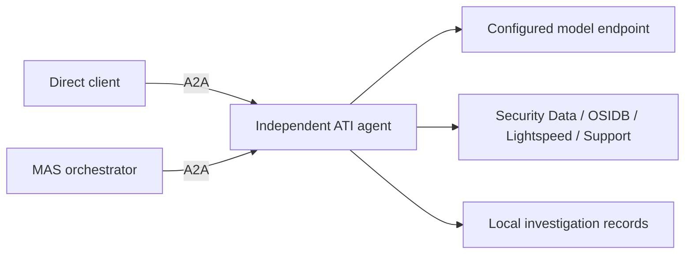

# ATI downstream agent PoC

An independent Actionable Threat Intelligence (ATI) agent that investigates a
supplied CVE, a public vulnerability identifier. It runs its own model and tool
loop and exposes an A2A (agent-to-agent) interface. MAS, a multi-agent
orchestration system, can delegate work to it without hosting the agent code.

The repository includes direct invocation, MAS registration and delegation,
capability-based selection between ATI and an arithmetic reference agent, and
automated tests. This is experimental code, not a production deployment.



The ATI package does not import or install MAS. Its model and source services
remain dependencies even when MAS is not running.

## Run the agent

Prerequisites: Git, [uv](https://docs.astral.sh/uv/), access to a compatible model
endpoint, and access to the source services you configure. Python is pinned in
`.python-version`; package versions are recorded in `uv.lock`.

```bash
git clone https://github.com/ikrispin/ati-downstream-agent-poc.git
cd ati-downstream-agent-poc
# Install the pinned interpreter; this uv release includes its download metadata.
uvx --from uv==0.13.9 uv python install 3.12.16 --no-bin
uv sync --locked --extra test --extra ui
cp -n .env.example .env
chmod 600 .env
```

Set these values in `.env`:

| Setting | Purpose |
|---|---|
| `ATI_A2A_TOKEN` | A random local bearer token required for agent invocation. |
| `ATI_LLM_BASE_URL`, `ATI_LLM_MODEL`, `ATI_LLM_API_KEY` | Model endpoint configuration. |
| `ATI_LIGHTSPEED_MCP_URL` | Lightspeed Model Context Protocol (MCP) service. |
| `ATI_SUPPORT_MCP_URL` | Support MCP service used for an explicitly supplied case. |

For example, generate a token with `openssl rand -hex 32` and save it privately
in `.env`. The example configuration contains no working credentials.

```bash
uv run --locked ati-downstream serve
```

| Endpoint | Address |
|---|---|
| Health | `http://127.0.0.1:8120/health` |
| Public capability description (Agent Card) | `http://127.0.0.1:8120/.well-known/agent-card.json` |
| Authenticated A2A JSON-RPC | `http://127.0.0.1:8120/a2a/jsonrpc` |

In another terminal, from the repository directory:

```bash
uv run --locked ati-downstream invoke \
  'Investigate CVE-2023-38545 using available security sources. Investigation ID: direct-demo-001'
```

Support is queried only when the current request explicitly supplies a case
number. Authenticate before requesting a case:

```bash
uv run --locked ati-downstream support-login
uv run --locked ati-downstream invoke \
  'Investigate CVE-2023-38545 and retrieve only Support Case <CASE_ID>. Investigation ID: direct-case-demo-001'
```

Replace `<CASE_ID>` with the case you intend to query. The login command opens a
loopback OAuth callback on `http://localhost:8121/callback`; complete sign-in using
the printed authorization URL. OAuth state is saved privately under `.local/`.

## Evidence sources

- **Red Hat Security Data:** public REST vulnerability information.
- **OSIDB:** queries explicitly public records; its deployment requires network
  access and Kerberos authentication (`kinit`, with `klist -s` to check a ticket).
- **Lightspeed:** MCP tools against the configured organization and service.
- **Support:** MCP access restricted to the case explicitly supplied in the
  current request. Missing case input leaves this source unrequested.

Unavailable sources produce explicit incomplete results. A completed A2A task
can contain a partial investigation; completion does not establish that every
source was retrieved.

## Use with MAS

[MAS integration](MAS_INTEGRATION_DESIGN.md) covers ownership, the optional local
platform setup, and compatibility patches. MAS source and UI repositories must
be obtained separately with the appropriate access; they are not bundled here.

With a compatible local MAS API and worker running:

```bash
uv run --locked python scripts/mas_workflow.py
uv run --locked python scripts/mas_workflow.py --prompt \
  'Investigate CVE-2023-38545 using available security sources. Investigation ID: mas-demo-001'
```

The helper creates an inventory entry and a fixed input → ATI → answer workflow.
For a planner that chooses between different agents, follow
[the agent selection guide](SELECTION.md).

## Verify

```bash
uv run --locked --extra test --extra ui ruff check src tests scripts
uv run --locked --extra test --extra ui pytest --cov=ati_downstream --cov-fail-under=80
```

The tests use local fixtures and mocked source/model clients; live credentials
are not needed. See [verification notes](VERIFICATION.md) for the distinction
between automated checks and earlier live lab evidence.

## Execution limits and state

Defaults are seven model rounds, twelve tool calls, 35 seconds per source call,
and a 240-second investigation deadline. Configure them through `.env`.

An explicit `Investigation ID: <identifier>` deduplicates submissions. The same
ID and request return the stored completed result. If execution is interrupted,
the current PoC rejects the unfinished claim; use a new investigation ID for a
deliberate retry. Checkpointing and automatic restart recovery are not implemented.

Investigation records persist in SQLite. The A2A task store is in memory, so task
polling does not survive an agent restart. MAS-to-agent cancellation propagation
also remains unverified. The local MAS setup uses development authentication.

`.env`, `.local/`, OAuth tokens, database files, generated certificates, and live
investigation records are excluded from Git. Source responses and case data
belong in private storage rather than committed examples.

## Layout

| Path | Contents |
|---|---|
| `src/ati_downstream/` | Agent execution, A2A, sources, OAuth, and MAS selection client. |
| `tests/` | Automated tests and a deterministic A2A compatibility fixture. |
| `scripts/` | MAS workflow setup and optional development platform tooling. |
| `patches/` | Compatibility changes for the pinned MAS baseline. |
| `compose.yaml` | Optional MAS development dependencies; not needed by ATI alone. |
| `VERSION_AUDIT.md` | Reproduction baseline and dependency caveats. |

## License and provenance

Apache-2.0; see [LICENSE](LICENSE). This standalone export originated in the ATI
downstream experiment. The Security Data and OSIDB connectors and their original
tests were adapted from an earlier ATI integration experiment; the agent loop,
A2A transport, OAuth storage, and downstream integration were developed for this
PoC. Third-party packages and separately obtained platform code retain their
respective licenses.
