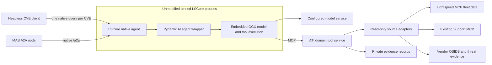

# ATI with the native Lightspeed Core agent

**Current PoC, 25 November 2026.** LSCore owns the model/tool loop, tool scheduling,
model retries, conversations, and native A2A endpoint. ATI supplies read-only MCP
tools for CVE evidence and provisional prioritization. MAS delegates to LSCore
through its native A2A endpoint.

The LSCore source is **upstream `main` pinned to
`7693565545044173814b1c5ad5aa66dd329e8b34`**, identifying itself as `0.8.0rc1`.
Its frozen dependency set includes OGX `1.2.5`. It is a reproducible snapshot,
not a moving checkout of today's `main` or a stable release selection. The
[baseline receipt](experiments/lscore-core-evaluation/baseline.json) records exact versions.



LSCore and Lightspeed MCP are different services. The former executes the agent;
the latter supplies connected customer fleet data. MAS is the multi-agent system
delegating work over A2A, the agent-to-agent protocol. MCP exposes callable tools.

## Native execution and ATI domain tools

| Tool | Responsibility |
|---|---|
| `begin_cve_assessment` | Register one CVE and the configured environment. Returns an assessment ID; makes no source or model calls. |
| `collect_cve_source` | Collect one named source for that registered CVE. The six choices are `redhat`, `osidb`, `lightspeed`, `fleet`, `support`, and `threat_intel`. |
| `finalize_cve_assessment` | Compute priority from saved observations, record missing evidence and save the structured assessment. Takes no model-supplied risk values. |

### Six collectors and their sources

A collector is one named fetching operation. The four core source families are
Red Hat Security Data, OSIDB, Lightspeed MCP and Support MCP. Lightspeed has two
collectors using the same configured connection. Public threat feeds supply the
additional EPSS and exploitation evidence needed for prioritization.

| Collector | Connection or feed | Evidence collected |
|---|---|---|
| `redhat` | Red Hat Security Data HTTP API | Vendor CVE details |
| `osidb` | OSIDB public flaw records | Public flaw and product-affect details |
| `lightspeed` | Configured Lightspeed MCP | CVE details from the connected environment |
| `fleet` | The same Lightspeed MCP | Affected systems, inventory details and system profiles |
| `support` | Configured Support MCP | Support cases matching the specified CVE |
| `threat_intel` | Public HTTP feeds: FIRST EPSS, CVE.org and CISA KEV | Exploitation probability and published exploitation assessments |

The fleet collector introduces no additional MCP connection. Threat intelligence
uses direct HTTP reads: FIRST's Exploit Prediction Scoring System (EPSS), CISA
assessments in CVE.org records, and CISA's Known Exploited Vulnerabilities (KEV)
catalog. It does not fetch or run exploit code. No MCP server is added for these feeds.

LSCore decides when to call these tools. Repeated
collection of the same source in one assessment reuses its observation, including
failure. Finalizing early produces a partial/failed domain outcome, never complete
evidence. Begin a new assessment to refresh data or retry a failed collector.

Domain records stay private in SQLite. Tools return selected facts rather than
case bodies, case numbers or host identifiers to the model. A local tool timeout
protects a collector; it does not cancel remote processing or enforce a native
LSCore whole-run budget.

## Setup

Use Python `3.12.16`, `uv`, Git, and network access to the source/model services.
OSIDB additionally uses `curl` with Kerberos support and an existing user ticket.
LSCore's broad development dependency environment remains separate from the small
ATI domain package. The frozen installation is documented in the evaluation.

From the repository root:

```bash
bash scripts/bootstrap.sh
cp -n .env.example .env
chmod 600 .env
```

Fill the model connection and existing MCP URLs in `.env`. Keep `ATI_SOURCE_MODE=live`
for real sources. The environment alias identifies one configured Lightspeed
connection, not arbitrary customer routing or independently verified identity.
Do not copy credentials into a tracked configuration file.

Authorize Support if no valid local authorization already exists:

```bash
uv run --locked ati-lscore support-login
```

Start these in separate terminals from this directory:

```bash
uv run --locked ati-lscore tools
```

```bash
uv run --locked python scripts/run_native.py
```

The launcher verifies the pinned checkout, loads `.env`, writes a private native
configuration and starts the upstream `lightspeed-stack` executable. It does not
modify LSCore or OGX. The generated model configuration duplicates connection
settings in the documented `native_override`, the verified forwarding workaround.

| Development surface | Address |
|---|---|
| Native LSCore readiness | `http://127.0.0.1:8140/readiness` |
| Native Agent Card | `http://127.0.0.1:8140/.well-known/agent-card.json` |
| Native A2A endpoint | `http://127.0.0.1:8140/a2a` |
| Native query endpoint | `http://127.0.0.1:8140/v1/query` |
| ATI domain MCP | `http://127.0.0.1:18143/mcp` |
| Support OAuth callback during sign-in | `http://localhost:8121/callback` |

This configuration is for loopback development with no native service
authentication. Production identity, network exposure and deployment are not
demonstrated. Credentials, synthesized configuration, logs and source records
remain under ignored `.env`/`.local` paths.

## Headless Journey 01

```bash
uv run --locked ati-lscore assess \
  --cve CVE-2023-38545 \
  --environment connected-organization \
  --output .local/reports/assessment.json
```

Repeat `--cve` for up to 100 distinct CVEs. The default is two independent native
requests at once; `--concurrency` accepts 1–10. Each invocation creates fresh
assessment IDs. The client pre-registers scope, submits one native query per CVE
and reads the domain record after LSCore returns. It never calls a model provider
or executes a model-suggested tool itself.

The report distinguishes **native request status** from **domain outcome**.
HTTP success does not establish complete evidence. If LSCore stops before
finalization, the record is `not_finalized`, even if its answer claims success.
`ATI_CLIENT_TIMEOUT=240` limits waiting; native server work may continue afterward.

Export a saved domain record without another model request:

```bash
uv run --locked ati-lscore show-assessment \
  --assessment-id '<ASSESSMENT_ID>' \
  --output .local/reports/evidence.json
```

The private report contains source observations and should not be committed.
This is explicit local evidence export, not a structured A2A or MAS artifact.

## Verification and limits

The [current verification receipt](verification.json) distinguishes real and
synthetic sources. The existing real model drove native LSCore in both runs:

- **Synthetic positive run:** six collectors succeeded; domain finalization
  completed with provisional `urgent_review`.
- **Real-source run:** five collectors succeeded; the existing Support MCP failed.
  Native query completed; the domain result correctly remained `partial`.
- Both runs used six explicit collection calls and one finalization call through
  native LSCore, plus MCP discovery.

The existing Support MCP and older data source are accepted for this PoC. Failed
or relevance-unverified searches remain missing evidence. Newer Support backend
migration, Errata enrichment and remediation are outside scope.

Native LSCore limitations still apply: tools ran sequentially within one native
response; outer retries can reset per-response allowances; a caller timeout does
not guarantee server cancellation. The pinned A2A endpoint produces text, not
ATI's typed result/outcome contract. See [framework gaps](experiments/lscore-core-evaluation/FRAMEWORK_GAPS.md),
[Journey 01](JOURNEY01.md), and [MAS integration](MAS_INTEGRATION.md).

## Checks

```bash
uv run --locked --extra test pytest --cov=ati_lscore --cov-fail-under=80
uv run --locked --extra test ruff check src tests scripts
uv run --locked --extra test ruff format --check src tests scripts
```

The tests use local fixtures and mocked network calls; no live credentials are required.
Publication checks are available with `uv run --locked python scripts/check_repository.py`.

## Documentation and diagrams

- [Google Docs visual guide](https://docs.google.com/document/d/1Ns0PGjMHCFx8Sqwkyp581kU5ecOgG_2nnOz6vndQ2GQ/edit).
- [Word visual guide](experiments/lscore-core-evaluation/LSCore-integration-visual-guide.docx) and [editable diagram sources](experiments/lscore-core-evaluation/visual-guide/README.md).
- [Native LSCore findings](experiments/lscore-core-evaluation/REPORT.md) and [framework gap table](experiments/lscore-core-evaluation/FRAMEWORK_GAPS.md).
- [Repository readiness](docs/github-readiness.md).

Apache-2.0; see [LICENSE](LICENSE). The source adapters and domain rules originated
in the [ATI integration project](https://github.com/zvigrinberg/actionable-threat-intelligence).
LSCore, MAS and their dependencies remain separate projects with their own licenses.
