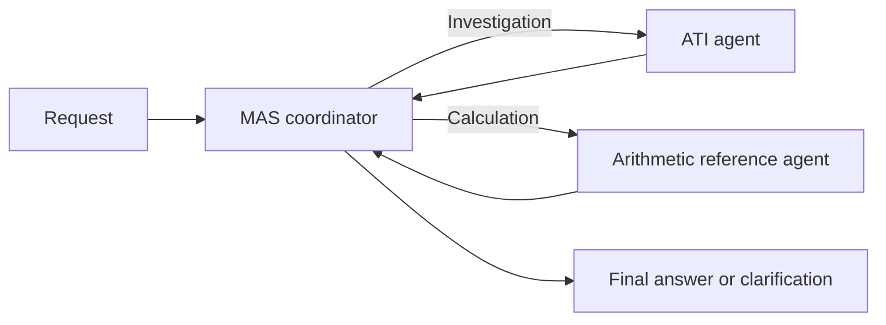

# MAS selection between downstream agents

This workflow connects a native MAS coordinator to two independent A2A agents:
ATI for vulnerability investigations and a deterministic arithmetic reference
agent. The coordinator uses the agents' capability cards to choose a worker.
There is no application rule routing vulnerability keywords to ATI.



## Configure

Start ATI and a compatible MAS API/worker using the [integration guide](MAS_INTEGRATION_DESIGN.md).
The planner uses the private `ATI_LLM_*` settings for its own model calls.
Then start the reference service in a separate terminal:

```bash
uv run --locked python -m ati_downstream.selection_reference
```

It listens on `127.0.0.1:8123`, uses `ATI_A2A_TOKEN`, and performs arithmetic
without model or source calls. Register both cards and save the workflow:

```bash
uv run --locked python -m ati_downstream.mas_selection
```

The helper creates **Downstream agent selection — ATI and arithmetic**. Repeated
setup refreshes the cards and retains existing resource/workflow identities.
It converts Agent Card field names to the representation expected by the pinned
MAS version; saving the remote URL alone does not supply the capability metadata.

The original fixed ATI workflow remains available. Selection here is among the
workers connected to this coordinator, not every agent registered anywhere in MAS.

## Exercise selection

Run each command from this repository with the services still running:

```bash
uv run --locked python -m ati_downstream.mas_selection \
  --prompt 'What is 12 * 7?' --expect-agent arithmetic
```

```bash
uv run --locked python -m ati_downstream.mas_selection \
  --prompt 'Investigate CVE-2023-38545 using available security sources. No Support Case number is supplied. Investigation ID: selection-demo-001' \
  --expect-agent ati
```

```bash
uv run --locked python -m ati_downstream.mas_selection \
  --prompt 'Book me a flight from London to Paris tomorrow.' --expect-agent none
```

```bash
uv run --locked python -m ati_downstream.mas_selection \
  --prompt 'Please investigate this issue.' --expect-agent none
```

Use a fresh investigation ID to require new evidence retrieval. Verification
checks actual delegated A2A task references, successful remote task states, and
the final coordinator answer. A plan alone or a completed session containing a
synthesis error does not pass. `none` requires no downstream invocation.

Session and chat records are saved privately under ignored
`.local/verification/selection/`. An ATI result may still be partial when a source
is unavailable; routing verification does not replace evidence evaluation.

Earlier live lab runs exercised all four paths successfully. The new selection
workflow was tested through the MAS API and worker, not through a browser chat.
The model compatibility patch described in the integration guide was required
for the tested model endpoint.
