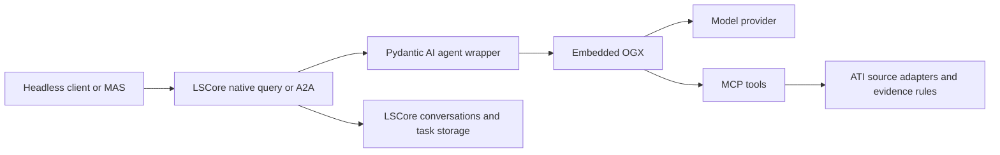

# Native LSCore evaluation and ATI integration

**APPENG-7003, 24 November 2026.** This directory records experiments against the
unmodified native Lightspeed Core loop. The runnable ATI PoC is in
[repository root](../../README.md). MAS delegates to native LSCore over A2A.

Read the [findings](REPORT.md), [framework gap table](FRAMEWORK_GAPS.md),
[native verification](../../verification.json), and
[visual guide](LSCore-integration-visual-guide.docx).

## Exact source baseline

We used **upstream `main`, pinned to an immutable commit**, rather than a separate
feature branch. The checkout identifies itself as a release candidate. The pin
makes source, dependency, configuration and timing evidence reproducible; it is
not an assertion that this is the newest or preferred stable release.

| Component | Tested baseline |
|---|---|
| Source | [7693565545044173814b1c5ad5aa66dd329e8b34](https://github.com/lightspeed-core/lightspeed-stack/tree/7693565545044173814b1c5ad5aa66dd329e8b34) |
| Reported LSCore version | `0.8.0rc1` |
| Providers submodule | `28a4c5106905e67b5c0971f030e70cc3e04a88eb` |
| Python | `3.12.16` |
| OGX / OGX API / OGX client | `1.2.5` |
| Pydantic AI / harness / skills | `2.38.0` / `0.30.0` / `1.4.0` |
| Native LSCore A2A SDK | `0.3.26` |
| MCP SDK | `1.30.0` |

[baseline.json](baseline.json) records source/lock hashes and inspected symbols.
[results/environment.json](results/environment.json) records installed versions.
No LSCore/OGX source patch or dependency upgrade was applied. The lost MCP error
text was already [fixed upstream](https://github.com/ogx-ai/ogx/pull/6745), but a
compatible fixed package/backport has not been installed or retested here.

## Execution boundary



OGX ran in library mode inside LSCore, not as a required separate server. Native
LSCore owns model/tool iteration. ATI business tools do not call models or choose
agent-loop branches. Native A2A advertises protocol `0.3.0` at `/a2a`.

## Experiments and evidence

The neutral scenario reads A=4 and B=7, then calculates 11. Most fault/timing checks
use a deterministic model fixture; normal/failure checks also used the existing
real model. Real-model skill compliance remains unverified.

| Capability | Evidence |
|---|---|
| Model/tool round trip and state isolation | [summary](results/summary.json) |
| Prompts profiles skills and unsupported callback candidate | [extension results](variants/http-extension-results.json), [findings](variants/findings.json) |
| Separate-request concurrency and sequential in-request tools | [source and timing](results/concurrency-origins.json) |
| Per-response limits outer retries and timeout scope | [limit origins](results/limits-origins.json), [deadline probe](results/deadline-probe.json) |
| Error formatting provider failures and retained native output | [error origins](results/error-origins.json), [adapter proof](results/error-adapter-probe.json) |
| Native A2A text and outcome limitations | [native contract evidence](results/structured-contract.json), [current native receipt](../../verification.json) |
| Existing accepted OGX fix | [upstream research](results/upstream-status.json) |

Native A2A contract evidence covers direct requests and MAS delegation. Native
A2A probing is available through `scripts/probe_a2a.py`.

## Reproduce the neutral experiments

The active ATI service and neutral baseline both use port 8140. Stop one before
starting the other. Run commands below from this evaluation directory. All raw
logs, checkout files and generated databases stay under ignored `.local`.

To install both isolated environments, first run `bash scripts/bootstrap.sh` from
`../..`. It clones the exact source pin and uses its frozen lockfile.
Alternatively clone the source manually and run `uv sync --frozen --python
3.12.16 --group dev --group ogxlibdev` inside that checkout.

Start these in separate terminals:

```bash
.local/upstream/.venv/bin/python scripts/fixture_server.py --port 18141 --log .local/evidence/model-calls.jsonl
```

```bash
.local/upstream/.venv/bin/python scripts/fixture_mcp.py --port 18142 --log .local/evidence/tool-calls.jsonl
```

```bash
.local/upstream/.venv/bin/lightspeed-stack -c config/lscore-fixture.yaml --synthesized-config-output .local/synthesized-ogx.yaml
```

After `/readiness` returns 200:

```bash
.local/upstream/.venv/bin/python scripts/run_probes.py
.local/upstream/.venv/bin/python scripts/probe_a2a.py --mode direct --output .local/evidence/e8-direct.json
```

The isolated real-model check reads `../../.env` internally, starts its own
native service on port 8145, and uses only neutral tools. It preserves an existing
service on that port and stops only its own process:

```bash
.local/upstream/.venv/bin/python scripts/probe_real_model.py --scenario baseline
.local/upstream/.venv/bin/python scripts/probe_real_model.py --scenario failure
```

[Variant instructions](variants/README.md) cover documented prompt/profile/skill
extensions, limit overrides, error conversion and model-connection forwarding.
Use the compatible MAS Python environment for `probe_a2a.py --mode mas-node`.
That probe exercises the native node, not a complete workflow. The current ATI
PoC also includes a [local workflow helper](../../MAS_INTEGRATION.md).

Full upstream tests, load testing, a reduced dependency installation, disconnected
operation and production deployment were not demonstrated. The frozen development
installation used 320 packages and about 2.40 GiB in the original neutral run.

## Scope and handoffs

The agreed evaluation covers prompt/tool customization and Python branching,
non-blocking calls and concurrency, and documented extensions without local
LSCore patches. Background jobs are outside this initial experiment. Restarting
history/task storage is different from durable business-run recovery.

The existing Support MCP and its older backend are accepted for this PoC. No
migration is required. Errata enrichment and remediation remain outside scope.
APPENG-7004 can compare LangGraph against the same scenario; that runtime comparison
has not been completed. Native LSCore is the sole retained PoC implementation,
not a claim that every framework-selection criterion has passed.
